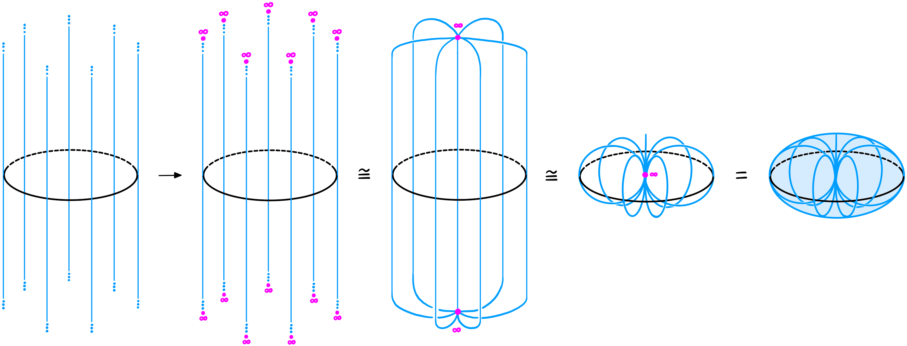



---

  <h1 style="
    margin:0;
    text-align:center;
    font-size:4.4cqi;
    line-height:1.05;
    white-space:nowrap;
  ">
    The MIT Geometry &amp; Topology Seminar, Fall 2026
  </h1>

---

<figure style="margin:0; width:100%;">
  
</figure>

---

Welcome to the website for the Fall 2026 iteration of the MIT Geometry & Topology Seminar, organized by [Joye Chen](https://math.mit.edu/directory/profile.html?pid=2584), [Ayodeji Lindblad](https://low-dim.top), and [Tom Mrowka](https://math.mit.edu/~mrowka/) (executive producer). The seminar meets on Mondays from 3:30PM - 4:30PM (50 minutes + questions) in room 449 of [MIT Building 2](https://maps.app.goo.gl/7qUtncvjbaUnE5SH9?g_st=ic). You can use [this link](https://calendar.google.com/calendar/u/0?cid=NGI4MGVlYzQ4MjI4YWU1NTAxY2NhNWYxZTE0N2M5ZGRlNTI4MTAxMzNkOTQyNDNkZDBmMTE0MDNiMjEzNTU5NUBncm91cC5jYWxlbmRhci5nb29nbGUuY29t) to add all seminar events to your Google Calendar.

---

**September 14.** [Bob Gompf](https://web.ma.utexas.edu/users/gompf/), The University of Texas at Austin - *The universal $\mathbb{R}^4$ and applications*.

We will discuss the universal $\mathbb{R}^4$ and universal smoothings more generally. This work was inspired by a 1986 paper of Freedman and Taylor but extends well beyond it. Simplifications of the main proof lead to a simpler definition and stronger results. One application is a 4-manifold for which the diffeomorphism types of its smoothings are as hard to classify as countable graphs (allowing infinite valence) up to graph isomorphism (joint with A. Panagiotopoulos). Another is to determine the compactly supported mapping class groups of a large class of smooth, open 4-manifolds (joint with P. Orson and A. Ray).

**September 21.** [Kyle Hayden](https://sites.google.com/view/kylehayden/home), Rutgers University-Newark - *Disordered handles and the complexity of h-cobordisms*. 

How do you measure the distance between exotic smooth structures on the same 4-manifold? One natural measure is the complexity of an h-cobordism between them. In this talk, I will compare several notions of complexity for h-cobordisms and discuss their relevance to studying 4-manifolds up to stable diffeomorphism. The main new ingredient is a surprising connection between the number of critical points on the h-cobordism and the order in which they appear.

    

**September 28.** [Hokuto Konno](https://www.ms.u-tokyo.ac.jp/~konno/eng_index.html), The University of Tokyo - *Families 10/8 revisited*.

Furuta's 10/8 inequality is a milestone in the applications of Seiberg–Witten theory to 4-dimensional topology, giving a strong constraint on the intersection forms of smooth spin 4-manifolds. A families version of the 10/8 theorem was considered by Baraglia in 2019, but applications of this families version have not yet been extensively explored. We consider a refinement of Baraglia's families 10/8 theorem and investigate what it tells us about the topology of families of 4-manifolds. This is joint work in progress with Yosuke Morita.

    

**October 5.** [Jiajun Yan](https://sites.google.com/view/jiajunyan/home), Rice University - *Toward a dynamical interpretation of the McKay correspondence via gauge theory*.

In this talk, we will present an exposition of the McKay correspondence, in particular, its various proofs and interpretations using different tools. We will then propose a dynamical way to think about this classical result inspired by Morse theory and gauge theory. Time permitting, we will explain in detail how this approach works in the cyclic cases of the McKay correspondence.

    

**October 12.** No speaker - *Indigenous Peoples' Day*.
    

**October 19.** [Dave Gabai](https://www.math.princeton.edu/people/david-gabai), Princeton University - *Loops of multi-spheres in* $\\#_k S^2\times S^2$ *and pseudo-isotopy*.

We discuss how a pseudo-isotopy of $S^4$ induces for some k, a loop of k embedded pairwise disjoint 2-spheres in $\#_k S^2\times S^2$ where the ith 2-sphere is based at the ith $\text{pt}\times S^2$ and how a loop of spheres induces a pseudo-isotopy. We define a non-trivial invariant with values in $\mathbb{Z}_2$ which vanishes on loops homotopic to ones having geometrically dual spheres.  Joint work with David Gay and Daniel Hartman.

    

**October 26.** [Susan Hermiller](https://shermiller.github.io/Susan_Hermiller/), University of Nebraska-Lincoln - *A tale of several unknotting conjectures*.

Unknotting number is a fundamental measure of how complicated a knot is, measuring how far it is from the unknot via crossing changes. Unknotting number is a challenging invariant to compute; a vast array of tools have been applied to its calculation, and many conjectures have grown up around it. In this talk I will discuss several conjectures aimed at simplifying the task of computing unknotting numbers. I will describe how our resolution of one of these conjectures several years ago led us more recently to resolve another as well as make a new conjecture. This is joint work with Mark Brittenham.

    

**November 2.** [Gheehyun Nahm](https://web.math.princeton.edu/~gn4470/), Princeton University - *An irreducible real projective plane in the 4-sphere*.

One challenge in studying knotted surfaces (surfaces embedded in 4-manifolds) is producing "genuinely new" examples. For example, until recently, every known knotted real projective plane in the 4-sphere could be expressed as the connected sum of a knotted 2-sphere and an unknotted real projective plane. Such knotted real projective planes are called reducible, or of Kinoshita type, and the Kinoshita conjecture stated that every knotted real projective plane in the 4-sphere is reducible.
I will begin by reviewing some constructions of knotted surfaces and surveying previous work on knotted real projective planes and irreducible knotted surfaces of other topological types. Then, I will present an irreducible real projective plane in the 4-sphere, which is joint work with Mark Hughes, Seungwon Kim, and Maggie Miller.

    

**November 9.** [Richard Bamler](https://rbamler.github.io/), University of California Berkeley - *Ancient cylindrical mean curvature flows and the Mean Convex Neighborhood Conjecture*.

We resolve the Mean Convex Neighborhood Conjecture for mean curvature flows in all dimensions and for all types of cylindrical singularities. Specifically, we show that if the tangent flow at a singular point is a multiplicity-one cylinder, then in a neighborhood of that point the flow is mean-convex, its time-slices arise as level sets of a continuous function, and all nearby tangent flows are cylindrical. Moreover, we establish a canonical neighborhood theorem near such points, which characterizes the flow via local models. Our proof relies on a complete classification of ancient, asymptotically cylindrical flows. We prove that any such flow is non-collapsed, convex, rotationally symmetric, and belongs to one of three canonical families: ancient ovals, the bowl soliton, or the flying wing translating solitons.

Our approach relies on two new techniques. The first, called the PDE-ODI principle, converts a broad class of parabolic differential equations into systems of ordinary differential inequalities. This framework bypasses many delicate analytic estimates used in previous work, and yields asymptotic expansions to arbitrarily high order. The second combines a new leading mode condition combined with an "induction over thresholds" argument" to obtain even finer asymptotic estimates.

This is joint work with Yi Lai.

    

**November 16.** [Liam Watson](https://personal.math.ubc.ca/~liam/), Universiry of British Columbia - *Structure in knot homology via Fukaya categories of punctured disks*.

Work with Kotelskiy and Zibrowius reformulates Bar-Natan’s relative version of Khovanov homology for tangles in terms of immersed multicurves in a 3-punctured disk. Said another way, invariants of tangles are recast as objects in the wrapped Fukaya category of this punctured disk, and the Bar-Natan invariant associated with a knot assembled from two tangles can be computed from the intersection of the associated objects. This perspective is useful towards establishing mutation invariance (over fields) for reduced Khovanov homology, for instance. Bar-Natan’s invariant admits a module structure, but this structure is not immediately obvious when considering intersections of multicurves. This talk will describe some ongoing work with Wenzhao Chen, which extracts the module structure from the intersection picture. 

    

**November 23.** No speaker - *Thanksgiving week*.
    

**November 30.** [Mira Wattal](https://www.bc.edu/bc-web/schools/morrissey/departments/math/people/grad-students/Mira-Wattal.html), Boston College - *Cutting and pasting skein lasagna modules*. 

Skein lasagna modules are a rapidly evolving tool developed for the study of 4-manifolds. We'll begin with a unified presentation of handle attachments for this 4-manifold invariant (defined with any suitable link theory), which generalizes existing formulae of Chen, Manolescu-Neithalath, Manolescu-Walker-Wedrich, and Ren-Willis; and end with an application to Gluck twisting. Time permitting, we'll discuss an extension of the first result to a variant of skein lasagna modules due to Ren-Sullivan-Wedrich-Willis-Zhang. (The first result is joint work with Gage Martin and Mary Stelow, the second is upcoming solo-work, and third is upcoming joint work with Gage Martin.)

    
**December 7.** [Chris Scaduto](https://www.math.miami.edu/~cscaduto/index.html), University of Miami.
    
    
**December 14.** [Dave Auckly](https://www.math.ksu.edu/~dav/), Kansas State University.

---

**Other seminars & past years:**

* [Boston area topology seminars](https://calendar.google.com/calendar/u/0/embed?src=028i07liimdqltnn999mpdqek4@group.calendar.google.com&ctz=America/New_York&gsessionid=OK)

* [Spring 2026](https://sites.google.com/view/isabellakhan/mit-gt-seminar-spring-2026)

* [Fall 2025](https://www.mit.edu/~gtseminar/)

* [Fall 2024 - Spring 2025](https://www.mit.edu/~gtseminar/2024-2025.html)

* [Spring 2023](https://www.mit.edu/~gtseminar/spring2023.html)

* [Fall 2021 - Spring 2022](https://sites.google.com/view/anthony-conway/activities/mit-geometry-and-topology-seminar-fall-2021)
    
---
    
 
